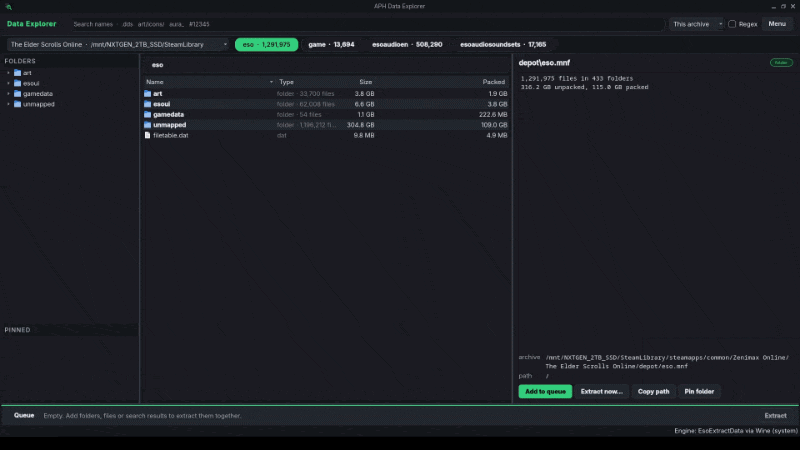
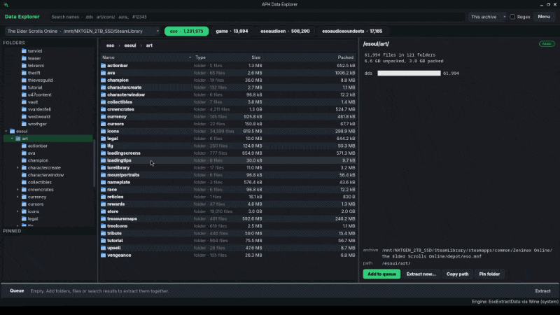

# APH Data Explorer

Browse, search, preview and extract the files inside The Elder Scrolls Online's game archives (`.mnf` / `.dat`) on Linux.

The archives are read by UESP's **EsoExtractData**, a Windows program that runs here under Wine or Steam's Proton. This app is the window around it: it reads the archives' file tables, shows them as folders, previews files, and turns what you pick into EsoExtractData runs. EsoExtractData is **not included**; you download it yourself (below).

## Requirements

- **Linux** with Python 3, **PySide6** and **Pillow**.
  - Arch / CachyOS / Manjaro: `sudo pacman -S pyside6 python-pillow`
  - Any distribution: `pip install --user PySide6 Pillow`
- **Wine** or **Proton**. Either one works; the app finds them on its own.
  - Arch / CachyOS / Manjaro: `sudo pacman -S wine`
  - Debian / Ubuntu / Mint: `sudo apt install wine`
  - Fedora: `sudo dnf install wine`
  - openSUSE: `sudo zypper install wine`
  - Or install any Proton version in Steam (Library > Tools). Proton builds in your Steam libraries and in `compatibilitytools.d` (GE-Proton and others) are listed under Menu > Settings.
- **EsoExtractData** by Dave Humphrey, from UESP: https://en.uesp.net/wiki/ESOMod:EsoExtractData
  Unpack the whole zip into any folder. `EsoExtractData.exe` needs the DLLs next to it, `oo2core_8_win64.dll` among them.
- **The Elder Scrolls Online**, live and PTS. Any of these is picked up:
  - Steam, native, Flatpak or Snap, with the game in any Steam library on any drive;
  - a Wine or Proton prefix (`~/.wine`, `~/Games`, Steam's compatdata, Lutris, Heroic, Bottles);
  - a folder under `/mnt`, `/media` or `/run/media`;
  - any game folder you add by hand.

On first start the app looks for the game, Wine/Proton, EsoExtractData and any folder of already-extracted files on its own (EsoExtractData and extracted folders take up to ten seconds; it searches your home folder and mounted drives). If something is still missing, it opens on a setup page that says what it is, how to install it, and has buttons to choose the EsoExtractData folder, open the UESP page, or add a game folder. Menu > Settings has Search and Find installs buttons to look again.

## Demos

<details>
<summary><b>Linux</b></summary>

**Browsing and previewing**



**Saving and audio preview**



</details>

## Start

```fish
./aph-data-explorer
```

To add it to your app menu, with its icon:

```fish
./install.sh
```

It writes `~/.local/share/applications/aph-data-explorer.desktop` pointing at wherever this folder is. Run it again if you move the folder; `./install.sh --uninstall` removes the entry.

## Using it

- **Archive chips** across the top switch between `eso` (the depot), `game` (UI and client files), the voice archives and the sound sets. The box on the left switches between live and PTS.
- **Folders** on the left jump anywhere; **Pinned** keeps the folders you use often (right click a folder in the list, or press Pin folder).
- **The list** in the middle shows the open folder: double click or Enter to open, Backspace to go up, click the path at the top to jump back. Sort by name, type or size.
- **Search** at the top: case-insensitive, either slash direction, `#12345` for a file index, Regex for patterns, and either this archive or every archive.
- **The inspector** on the right previews the selected file:
  - DDS, `.xv4` (a DDS texture in a small wrapper) and other images on a checkerboard;
  - Lua, XML and shaders as text, `.lang` as a CSV table;
  - sounds in a player with play/pause, a seek bar, a volume slider and an Output box (System default follows your desktop's default output when it changes, for example when Bluetooth headphones connect; the depot's numbered sound rows are Ogg or WAV once fetched);
  - anything else as hex. For a folder it shows its size and what kinds of files it holds.
- **The queue** at the bottom collects folders, files and search results (Ctrl+E shows or hides it; drag its top edge to resize). Untick kinds you don't want, add a name filter, pick where to write and whether to keep the archive's folder paths, convert DDS to PNG or LANG to CSV, then Extract. The app works out the fastest set of EsoExtractData runs and keeps only what you picked.
- **Menu**: queue files by name or extension (the `--matchfilename '\art\maps\'` way), map tiles only, everything sorted into kinds (hours, around 500 GB), LANG tools (to CSV, to text, back to LANG, compare two files), settings, theme (Dark or Light) and accent color (green or blue).

## Files it keeps

- `~/.cache/aph-data-explorer/tables/`: each archive's file table, rebuilt when the `.mnf` changes after a game patch (Menu > Read the file tables again forces it).
- `~/.cache/aph-data-explorer/preview/`: fetched files for previews, trimmed to the size set in Settings.
- `~/.config/APH/DataExplorer.conf`: game folders, the EsoExtractData folder, the Wine/Proton choice, extracted folders, pins, theme and the last queue options.
- Wine prefixes: `~/.local/share/wineprefixes/esoextract` (Wine) and `esoextract-proton` (Proton).

## Tests

```fish
python3 -m unittest discover -s tests
env APH_DE_LIVE=1 python3 -m unittest discover -s tests
```

The second run also extracts one file from the installed game through Wine. It finds EsoExtractData the same way the app does; set `APH_DE_TOOL` to its folder to skip the search.

## License

Copyright © 2026 @APHONlC. All rights reserved. See LICENSE.md

**Disclaimer:**
- **Licensing Boundary:** The all-rights-reserved terms above cover only this project's own code and logic. I do not claim ownership of the names, trademarks, brands or code of any third-party tools, libraries, add-ons or services it works with, depends on or is compatible with. This license grants no rights to any of them and does not override their own licenses or Terms of Service.
- **Not bundled:** EsoExtractData, its DLLs, Wine and Proton are not part of this project and are not distributed with it. You download and install them yourself, under their own terms.
- **Liability:** Provided "as is."

> [!NOTE]
> This application is not created by, affiliated with, or sponsored by ZeniMax Media Inc. or its affiliates. The Elder Scrolls® and related logos are registered trademarks or trademarks of ZeniMax Media Inc. in the United States and/or other countries. All rights reserved.

For permissions or inquiries, contact @APHONlC on ESOUI.

## Credits

I would like to thank the following, for providing resources and their awesome projects:

- [EsoExtractData](https://en.uesp.net/wiki/ESOMod:EsoExtractData) <sub>*(Dave Humphrey, UESP: reads every archive file this app shows)*</sub>
- Oodle <sub>*(RAD Game Tools, now Epic Games: the decompressor inside EsoExtractData, `oo2core_8_win64.dll`)*</sub>
- [Qt for Python (PySide6)](https://doc.qt.io/qtforpython-6/) <sub>*(the window)*</sub>
- [Pillow](https://python-pillow.github.io/) <sub>*(DDS and image previews)*</sub>
- [Wine](https://www.winehq.org/) and Proton <sub>*(run EsoExtractData on Linux)*</sub>

**Testers & Suggestions:**

- @Drakius192
